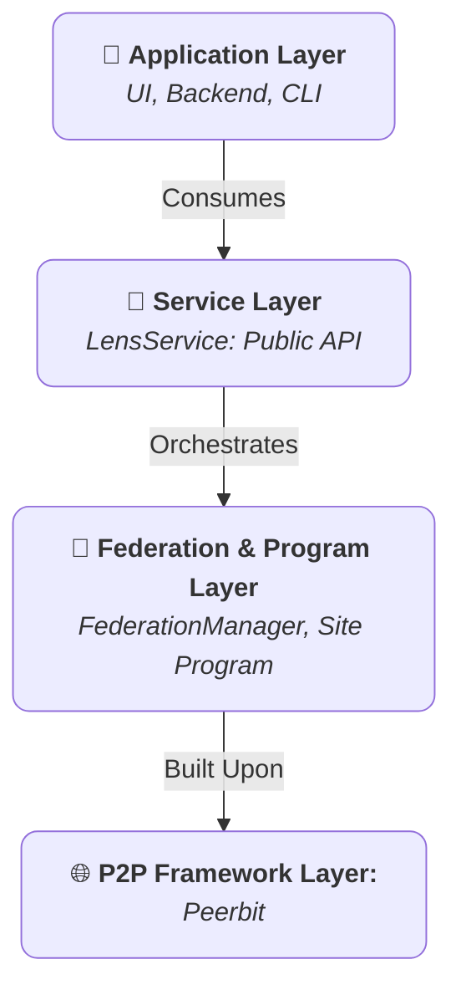

+++
date = '2025-07-22T05:44:53+02:00'
draft = false
title = 'Conceptos fundamentales'
weight = 2
+++

El SDK de Lens esta disenado alrededor de un conjunto de componentes robustos e interoperables. Comprender bien estos conceptos fundamentales es esencial para aprovechar toda la potencia y seguridad del SDK. Este documento ofrece una vision detallada de los pilares fundacionales de la arquitectura Lens: `LensService`, el programa `Site`, el modelo de federacion y el sistema de control de acceso.

## 1. La arquitectura por capas

El SDK emplea una arquitectura estricta por capas para promover la modularidad, la seguridad y la mantenibilidad. Cada capa tiene una responsabilidad distinta y la comunicacion fluye verticalmente a traves de interfaces bien definidas.

* **Capa de servicio (`LensService`):** esta es la interfaz publica canonica del SDK. Es el unico punto de entrada para cualquier aplicacion consumidora. Su objetivo es proporcionar una API estable, de alto nivel y asincrona que abstrae completamente la complejidad de la red P2P subyacente y de la logica del programa. La capa de servicio se encarga de gestionar el ciclo de vida del cliente P2P y del programa `Site` activo.

* **Capa de programa (programa `Site`):** este es el backend descentralizado "on-chain" de la aplicacion. El programa `Site` es un "smart contract" replicable y con estado que define los esquemas de datos, las bases de datos y las reglas inmutables que gobiernan el acceso a los datos. Es la fuente de verdad definitiva para todo el contenido y todos los permisos dentro de un `Site`.

* **Capa de federacion (`FederationManager`):** este es un componente interno especializado gestionado por `LensService`. Orquesta toda la comunicacion entre programas. Mientras el programa `Site` define *que* datos existen, `FederationManager` define *como* se descubren, sincronizan y comparten esos datos entre distintas instancias de `Site`.

* **Capa del framework P2P (Peerbit):** la capa fundacional que proporciona las primitivas necesarias para redes peer-to-peer, creacion de bases de datos, replicacion de datos e identidad criptografica. El SDK de Lens esta construido directamente sobre este framework robusto.

## 2. El programa `Site`: una entidad digital soberana

La construccion central del ecosistema Lens es el `Site`. Conceptualmente, un `Site` es un espacio digital soberano, direccionable y autocontenido. Funciona como una instancia de aplicacion descentralizada completa con sus propias bases de datos y su propio sistema de control de acceso.

### Caracteristicas clave de un `Site`

* **Direccion unica y verificable:** cada `Site` se identifica mediante una direccion criptografica permanente derivada de la clave publica de su propietario y de sus parametros iniciales. Esta direccion se utiliza para localizar, abrir e interactuar con el `Site` en la red.
* **Almacenes de datos estructurados:** un `Site` es una coleccion de almacenes de datos discretos y orientados a propositos concretos para `Releases`, `ContentCategories`, `Subscriptions` y mas. Este enfoque estructurado garantiza la integridad de los datos y una organizacion clara.
* **Permisos explicitos:** el acceso a un `Site` no es publico por defecto. Todos los permisos de escritura son concedidos explicitamente por un **Administrator** mediante un robusto sistema de control de acceso basado en roles (RBAC).

## 3. El modelo de federacion: intercambio de datos con principios

La federacion es el proceso mediante el cual instancias independientes de `Site` comparten datos. El SDK de Lens implementa un modelo basado en subscriptions para garantizar que todo intercambio de datos sea intencional y seguro.

### El ciclo de vida de la federacion

1. **Subscription explicita:** el proceso lo inicia una persona usuaria con permiso `subscription:manage`, normalmente un `Moderator` o un `Admin`. Para federarse, crea un registro `Subscription` que contiene la direccion del `Site` objetivo. Esta accion es una declaracion deliberada de confianza.

2. **Sincronizacion de estado:** al crear una `Subscription`, `FederationManager` realiza dos tipos de sincronizacion:
    * **Sincronizacion historica:** un proceso puntual que se conecta al `Site` remoto y replica su contenido publico existente, por ejemplo sus `Releases`.
    * **Sincronizacion en vivo:** el gestor se suscribe al tema pub/sub dedicado del `Site` remoto, creando un canal persistente de comunicacion en tiempo real para actualizaciones inmediatas.

3. **Procedencia de los datos:** todos los datos recibidos mediante federacion son inmutables y conservan la firma criptografica de su autor original y la direccion de su `Site` de origen. Esto garantiza que la fuente de todo contenido pueda verificarse.

4. **Finalizacion del ciclo:** si se elimina una `Subscription`, `FederationManager` realiza una operacion de limpieza purgando de sus bases de datos locales todos los datos asociados al `Site` dado de baja.

## 4. El sistema de control de acceso (RBAC)

La seguridad es parte integral del programa `Site`. El sistema se basa en un modelo robusto y seguro de **Role-Based Access Control (RBAC)** gestionado por un `RoleBasedccessController` interno dedicado. Este controlador es la autoridad ultima para todas las acciones dentro de un `Site`.

### Identidad y firma

Toda accion que modifica un `Site`, como anadir una release o asignar un rol, debe firmarse criptograficamente. El SDK de Lens admite dos modelos de identidad:

1. **Identidad predeterminada del nodo:** si inicializas `LensService` sin especificar una identidad personalizada, usara una identidad autogenerada vinculada al propio nodo Peerbit. Esto es adecuado para scripts del lado del servidor o nodos sin interfaz donde se desea una identidad unica y estable.

2. **Identidad personalizada de cartera:** para aplicaciones orientadas a personas usuarias, el enfoque recomendado es proporcionar una identidad derivada de la cartera de la persona usuaria, por ejemplo MetaMask. Cuando instancias `LensService` con esta identidad personalizada, **todas las acciones posteriores se firman con la cartera de la persona usuaria**. Esto garantiza que la persona usuaria, y no el nodo de la aplicacion, sea la verdadera propietaria y autora de su contenido. Esta es la base de la soberania de datos en el SDK de Lens.

### Los componentes de RBAC

* **Administradores (`TrustedNetwork`):** en el nivel superior existe una `TrustedNetwork` de administradores. Cualquier persona cuya clave publica se encuentre en esta red se considera **Admin**. Los admins tienen permisos universales y son las unicas personas usuarias que pueden gestionar el propio sistema RBAC, por ejemplo crear nuevos roles, asignarlos a personas usuarias o anadir otros admins. La persona creadora inicial de un `Site` es su primer `Admin`.

* **Roles:** un `Role` es una coleccion con nombre de permisos especificos. Un `Site` se inicializa con un conjunto de roles predeterminados y los admins pueden crear nuevos roles personalizados segun sea necesario.

* **Permisos:** un `Permission` es una cadena granular que representa una accion especifica, normalmente con el formato `"resource:action"`, por ejemplo `"release:delete"`.

* **Asignaciones:** una `Assignment` es un vinculo verificable entre la clave publica de una persona usuaria y un `Role`. Una persona usuaria obtiene permisos en virtud de los roles que se le asignan.

### Tabla de roles y permisos predeterminados

Un `Site` incluye un conjunto claro de roles predeterminados, lo que proporciona una estructura de permisos sensata desde el primer momento. Un **Admin** puede realizar todas las acciones enumeradas a continuacion.

| Action / Permission (`resource:action`) | Moderator | Member | Guest | Description                                                              |
|-----------------------------------------|:---------:|:------:|:-----:|--------------------------------------------------------------------------|
| **`release:create`**                    | ✅        | ✅     | ❌    | Puede publicar nuevos documentos `Release`.                              |
| **`release:edit:own`**                  | ✅        | ✅     | ❌    | Puede editar los documentos `Release` que haya publicado personalmente.  |
| **`release:edit:any`**                  | ✅        | ❌     | ❌    | Puede editar documentos `Release` publicados por *cualquier* persona usuaria del sitio. |
| **`release:delete`**                    | ✅        | ❌     | ❌    | Puede eliminar cualquier `Release` del sitio.                            |
| **`featured:manage`**                   | ✅        | ❌     | ❌    | Puede crear, editar o eliminar entradas `FeaturedRelease`.               |
| **`category:manage`**                   | ✅        | ❌     | ❌    | Puede crear, editar o eliminar documentos `ContentCategory`.             |
| **`blocklist:manage`**                  | ✅        | ❌     | ❌    | Puede crear o eliminar entradas `BlockedContent`.                        |
| **`subscription:manage`**               | ✅        | ❌     | ❌    | Puede suscribirse a otros sitios o dejar de seguirlos.                   |

* **Guest (rol implicito):** este es el estado predeterminado de cualquier persona usuaria que no sea admin ni tenga roles asignados. Los `Guests` tienen acceso de solo lectura y no pueden realizar operaciones de escritura.

### Federacion y permisos

El modelo RBAC se extiende de forma inteligente al contenido federado. Aunque la confianza se basa principalmente en la subscription, el SDK de Lens proporciona una capacidad de control local muy potente: **un `Admin` o `Moderator` local siempre puede actuar sobre contenido federado**, por ejemplo eliminar una publicacion obsoleta procedente de un sitio ya no suscrito. Esto garantiza que las personas propietarias del sitio local mantengan el control ultimo sobre el contenido almacenado en sus bases de datos.
