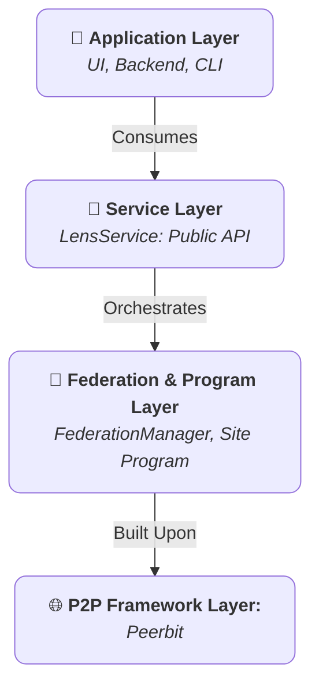

+++
date = '2025-07-22T05:44:53+02:00'
draft = false
title = 'Concepts fondamentaux'
weight = 2
+++

Le SDK Lens est concu autour d'un ensemble de composants robustes et interoperables. Une bonne maitrise de ces concepts fondamentaux est essentielle pour exploiter toute la puissance et toute la securite du SDK. Ce document offre une vue detaillee des piliers fondateurs de l'architecture Lens : `LensService`, le programme `Site`, le modele de federation et le systeme de controle d'acces.

## 1. L'architecture en couches

Le SDK adopte une architecture stricte en couches afin de favoriser la modularite, la securite et la maintenabilite. Chaque couche a une responsabilite distincte, et la communication circule verticalement au travers d'interfaces bien definies.

* **Couche de service (`LensService`) :** il s'agit de l'interface publique canonique du SDK. C'est le seul point d'entree pour toute application consommatrice. Son role est de fournir une API stable, asynchrone et de haut niveau qui abstrait entierement la complexite du reseau P2P et de la logique de programme sous-jacents. La couche de service gere le cycle de vie du client P2P et du programme `Site` actif.

* **Couche programme (programme `Site`) :** il s'agit du backend decentralise "on-chain" de l'application. Le programme `Site` est un "smart contract" replicable et stateful qui definit les schemas de donnees, les bases de donnees et les regles immuables governant l'acces aux donnees. C'est la source de verite ultime pour tout le contenu et toutes les autorisations au sein d'un `Site`.

* **Couche de federation (`FederationManager`) :** c'est un composant interne specialise gere par `LensService`. Il orchestre toute la communication inter-programmes. Alors que le programme `Site` definit *quelles* donnees existent, le `FederationManager` definit *comment* ces donnees sont decouvertes, synchronisees et partagees entre les differentes instances de `Site`.

* **Couche du framework P2P (Peerbit) :** la couche fondamentale qui fournit les primitives necessaires au reseautage pair a pair, a la creation de bases de donnees, a la replication de donnees et a l'identite cryptographique. Le SDK Lens est construit directement au-dessus de ce cadre robuste.

## 2. Le programme `Site` : une entite numerique souveraine

La construction centrale de l'ecosysteme Lens est le `Site`. Conceptuellement, un `Site` est un espace numerique souverain, adressable et autonome. Il fonctionne comme une instance d'application decentralisee complete avec ses propres bases de donnees et son propre systeme de controle d'acces.

### Caracteristiques principales d'un `Site`

* **Adresse unique et verifiable :** chaque `Site` est identifie par une adresse cryptographique permanente derivee de la cle publique de son proprietaire et de ses parametres initiaux. Cette adresse est utilisee pour localiser, ouvrir et interagir avec le `Site` sur le reseau.
* **Magasins de donnees structures :** un `Site` est compose de plusieurs magasins de donnees distincts et specialement concus pour les `Releases`, `ContentCategories`, `Subscriptions` et plus encore. Cette approche structuree assure l'integrite des donnees et une organisation claire.
* **Autorisations explicites :** l'acces a un `Site` n'est pas public par defaut. Toutes les autorisations d'ecriture sont explicitement accordees par un **Administrator** via un systeme robuste de controle d'acces base sur les roles (RBAC).

## 3. Le modele de federation : un echange de donnees fonde sur des principes

La federation est le processus par lequel des instances independantes de `Site` partagent des donnees. Le SDK Lens met en oeuvre un modele fonde sur les subscriptions pour garantir que tous les echanges de donnees sont intentionnels et securises.

### Le cycle de vie de la federation

1. **Subscription explicite :** le processus est initie par un utilisateur disposant de la permission `subscription:manage`, en general un `Moderator` ou un `Admin`. Pour federer, cette personne cree un enregistrement `Subscription` contenant l'adresse du `Site` cible. Cette action constitue une declaration de confiance deliberee.

2. **Synchronisation d'etat :** a la creation d'une `Subscription`, le `FederationManager` realise deux types de synchronisation :
    * **Synchronisation historique :** un processus ponctuel qui se connecte au `Site` distant et replique son contenu public existant, comme les `Releases`.
    * **Synchronisation live :** le gestionnaire s'abonne au topic pub/sub dedie du `Site` distant, creant un canal de communication persistant en temps reel pour les mises a jour immediates.

3. **Provenance des donnees :** toutes les donnees recues via federation sont immuables et conservent la signature cryptographique de leur auteur d'origine ainsi que l'adresse de leur `Site` d'origine. Cela garantit que la source de tout contenu peut etre verifiee.

4. **Fin de cycle :** si une `Subscription` est supprimee, le `FederationManager` effectue un nettoyage en purgeant de ses bases de donnees locales toutes les donnees associees au `Site` desabonne.

## 4. Le systeme de controle d'acces (RBAC)

La securite est un element central du programme `Site`. Le systeme repose sur un modele robuste et securise de **Role-Based Access Control (RBAC)** gere par un `RoleBasedccessController` interne dedie. Ce controleur est l'autorite ultime pour toutes les actions au sein d'un `Site`.

### Identite et signatures

Toute action qui modifie un `Site`, comme l'ajout d'une release ou l'attribution d'un role, doit etre signee cryptographiquement. Le SDK Lens prend en charge deux modeles d'identite :

1. **Identite par defaut du noeud :** si vous initialisez `LensService` sans fournir d'identite personnalisee, il utilisera une identite auto-generee liee au noeud Peerbit lui-meme. Cela convient aux scripts cote serveur ou aux noeuds sans interface, quand une identite unique et stable est souhaitee.

2. **Identite de portefeuille personnalisee :** pour les applications destinees aux utilisateurs, l'approche recommandee est de fournir une identite derivee du portefeuille de l'utilisateur, par exemple MetaMask. Lorsque vous instanciez `LensService` avec cette identite, **toutes les actions suivantes sont signees par le portefeuille de l'utilisateur**. Cela garantit que l'utilisateur, et non le noeud applicatif, reste le veritable proprietaire et auteur de son contenu. C'est la base de la souverainete des donnees dans le SDK Lens.

### Les composants du RBAC

* **Administrateurs (`TrustedNetwork`) :** au sommet se trouve un `TrustedNetwork` d'administrateurs. Toute personne dont la cle publique appartient a ce reseau est consideree comme **Admin**. Les admins disposent de permissions universelles et sont les seuls a pouvoir gerer le systeme RBAC lui-meme, par exemple creer de nouveaux roles, les attribuer a des utilisateurs ou ajouter d'autres admins. Le createur initial d'un `Site` devient son premier `Admin`.

* **Roles :** un `Role` est un ensemble nomme de permissions specifiques. Un `Site` est initialise avec un ensemble de roles par defaut, et les admins peuvent creer d'autres roles personnalises si necessaire.

* **Permissions :** une `Permission` est une chaine granulaire representant une action precise, generalement au format `"resource:action"`, par exemple `"release:delete"`.

* **Attributions :** une `Assignment` est un lien verifiable entre la cle publique d'un utilisateur et un `Role`. Un utilisateur obtient des permissions du fait des roles qui lui sont attribues.

### Tableau des roles et permissions par defaut

Un `Site` est livre avec un ensemble clair de roles par defaut, ce qui fournit une structure d'autorisations pertinente des le depart. Un **Admin** peut effectuer toutes les actions listees ci-dessous.

| Action / Permission (`resource:action`) | Moderator | Member | Guest | Description                                                              |
|-----------------------------------------|:---------:|:------:|:-----:|--------------------------------------------------------------------------|
| **`release:create`**                    | ✅        | ✅     | ❌    | Peut publier de nouveaux documents `Release`.                            |
| **`release:edit:own`**                  | ✅        | ✅     | ❌    | Peut modifier les documents `Release` qu'il ou elle a publies.           |
| **`release:edit:any`**                  | ✅        | ❌     | ❌    | Peut modifier les documents `Release` publies par *n'importe quel* utilisateur du site. |
| **`release:delete`**                    | ✅        | ❌     | ❌    | Peut supprimer n'importe quelle `Release` du site.                       |
| **`featured:manage`**                   | ✅        | ❌     | ❌    | Peut creer, modifier ou supprimer des entrees `FeaturedRelease`.         |
| **`category:manage`**                   | ✅        | ❌     | ❌    | Peut creer, modifier ou supprimer des documents `ContentCategory`.       |
| **`blocklist:manage`**                  | ✅        | ❌     | ❌    | Peut creer ou supprimer des entrees `BlockedContent`.                    |
| **`subscription:manage`**               | ✅        | ❌     | ❌    | Peut s'abonner a d'autres sites ou s'en desabonner.                      |

* **Guest (role implicite) :** c'est le statut par defaut de toute personne qui n'est ni admin ni titulaire d'un role attribue. Les `Guests` disposent d'un acces en lecture seule et ne peuvent effectuer aucune ecriture.

### Federation et permissions

Le modele RBAC s'etend intelligemment au contenu federatif. Meme si la confiance repose d'abord sur la subscription, le SDK Lens offre une capacite de reprise de controle puissante : **un `Admin` ou `Moderator` local peut toujours agir sur le contenu federatif**, par exemple supprimer une publication obsolete provenant d'un site desabonne. Cela garantit que les proprietaires du site local gardent le controle ultime du contenu stocke dans leurs bases de donnees.
